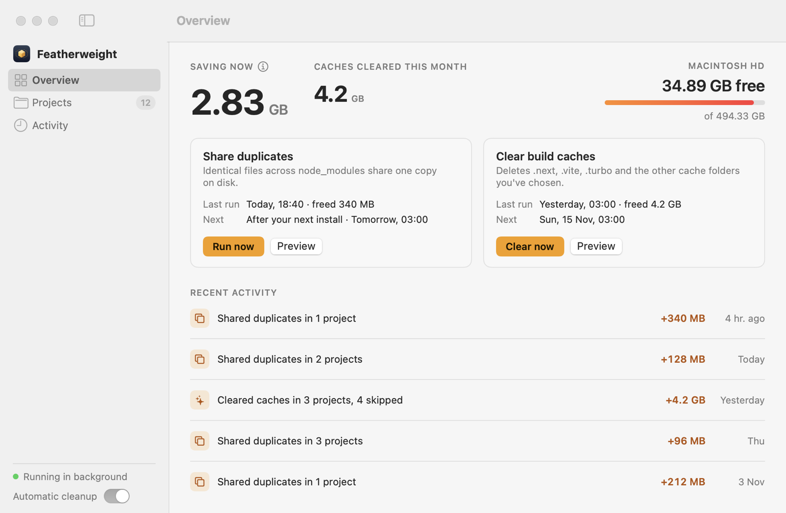
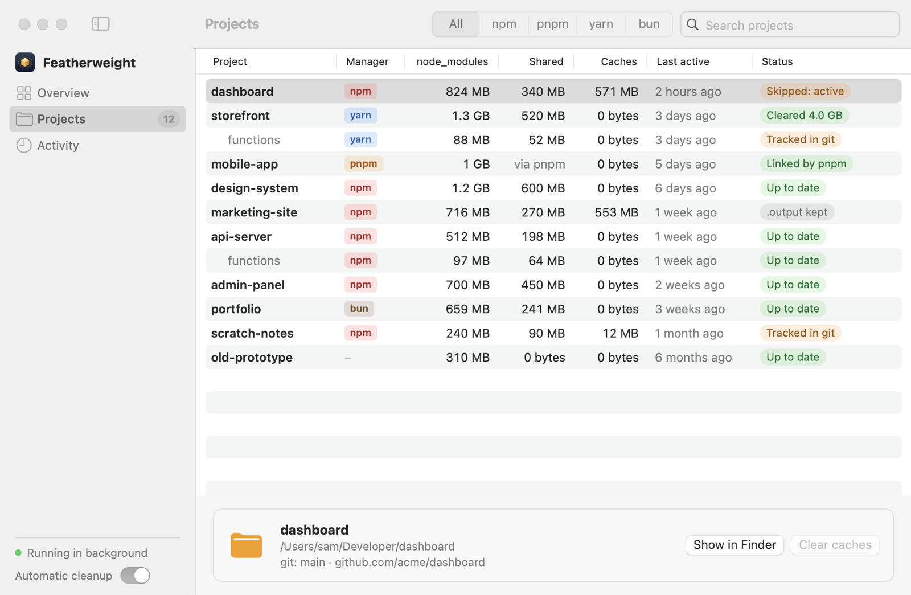
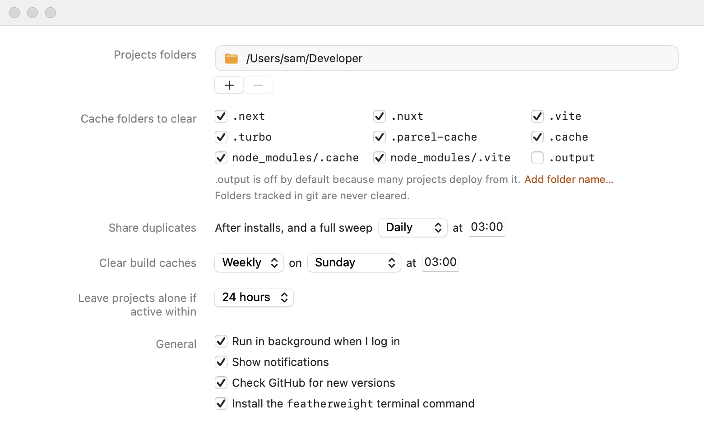

<p align="center">
  
</p>

<h1 align="center">Featherweight</h1>

<p align="center"><em>node_modules, but light.</em></p>

<p align="center">
  <picture>
    <source media="(prefers-color-scheme: dark)" srcset="docs/images/overview-dark.png">
    
  </picture>
</p>

Featherweight is a small, native Mac app that wins back disk space from your JavaScript
projects, quietly, without changing how you work. It is free, MIT-licensed, has no
telemetry, and its only network call is an optional once-a-day check for a newer version.

## What it does

Featherweight saves space in two ways, both automatic, and you can run either by hand:

1. **Share duplicates.** The same package version often sits in a dozen different
   `node_modules` folders. Featherweight finds byte-identical files across all of them and
   makes them share one copy on disk. Every project keeps its own real `node_modules`
   folder with every file in place.
2. **Clear build caches.** Folders like `.next`, `.nuxt`, `.vite`, `.turbo`,
   `.parcel-cache` and `.cache` grow into gigabytes and rebuild themselves on demand.
   Featherweight deletes them on a schedule (weekly by default), as long as it's safe.

A third piece ties these together: a **background helper** that starts when you log in, has
no Dock or menu bar icon, and does the scheduled work. The app is a normal window you open
to see what happened, change settings, or run a job. Closing it doesn't stop the helper.
There is also a [`featherweight` terminal command](#the-featherweight-command).

How much does it save? These numbers were measured on the Mac it was built for, which had
7.85 GB of `node_modules` content and was 95% full:

- About **2.8 GB** of that `node_modules` content was byte-identical duplicates.
- Build caches (`.next`, `.nuxt`, `.vite`, `.turbo`, `.parcel-cache`, `.cache`) added up to
  about **12.6 GB**. `.next` alone was 4.7 GB, 4 GB of it in a single project.

Your numbers will differ. The first-launch screen scans your folders and tells you what
Featherweight expects to free before it changes anything.

## How sharing duplicates saves space

Featherweight uses APFS clones, a feature of the Mac's file system. A clone is a file that
looks and behaves like an ordinary copy, but shares its data blocks on disk with the file it
was cloned from. Two clones of a 5 MB file use 5 MB together, not 10.

When Featherweight finds two identical files (same size, same SHA-256 hash of the full
contents), it replaces one with a clone of the other. That's all it does:

- **Nothing about your project changes.** `package.json`, lockfiles, and your npm, pnpm,
  yarn or bun commands are exactly as they were. Nothing is committed. On GitHub or on
  another machine, `npm install` behaves as it always has.
- **Projects stay independent.** Clones are copy-on-write: if a project later changes one of
  its files, that file quietly gets its own blocks, and no other project is affected.
- **Replacements are atomic and lossless.** Featherweight makes the clone under a temporary
  name next to the original, copies over the original's permissions, owner, timestamps and
  extended attributes, and renames it into place. If any step fails, the original is left
  as it was.
- **It's cheap to repeat.** Featherweight remembers file hashes, so later sweeps don't read
  files that haven't changed.

> **Finder's "Get Info" will still show the full size.** Finder adds up the size of every
> file without knowing that some of them share space, so a `node_modules` folder looks the
> same as before. The **Saving now** number on the Overview screen is the real figure, and
> your drive's free space is the proof.

## Safety: what is never touched

Disk space is not worth a broken project. Featherweight follows these rules:

**It never changes your projects' files.** `package.json`, lockfiles, scripts, and source
files are never edited. It never runs a package manager, and it never commits or pushes
anything.

**Only the folders you choose.** It works inside the projects folders you pick in Settings
and nowhere else. Folders in iCloud Drive (or any other cloud-sync folder) are refused,
because offloaded files would have to be downloaded and every change would sync again.

**When sharing duplicates, it skips:**

- symlinks and empty files
- files with more than one hard link. pnpm hard-links into its store, so cloning one would
  break that link and save nothing
- files on a different volume from their match
- files that already share space with their match (bun does this itself)
- anything modified in the last minute, and any `node_modules` folder that has had file
  activity in the last minute, so it never works on top of a running install

Dev servers keep running while it works: a replaced file keeps its contents, permissions
and modification time. Only its inode number changes.

**When clearing build caches, it skips:**

- **Anything tracked in git.** If any file in a cache folder is tracked by git in that
  project's repository, the folder is left alone. If git can't say, it is left alone too.
- **Projects you are working on.** If any file in a project changed within the activity
  window (24 hours by default, set in Settings), its caches are left alone. That protects
  running dev servers, which write to `.next` constantly. This includes projects nested
  inside it.
- **Folders you turned off.** `.output` is off by default, because many projects deploy
  from it.
- **Folders that aren't plain folders anymore**, for example one that was swapped for a
  symlink while Featherweight was working.

Cache folders are deleted permanently, not moved to the Trash, since they regenerate and
the Trash wouldn't free space until you emptied it. **Preview** (in the app) and
`--dry-run` (in the terminal) show exactly what would be freed and what would be skipped,
and why, without changing anything.

**One job at a time.** The helper, the app and the terminal command share a lock, so two
jobs never run at once.

**Light on the Mac.** The helper sleeps between events and timers (it never polls), uses
background priority with throttled disk access, and the whole download is about 4 MB.

## Requirements

- macOS 14 (Sonoma) or later, on Apple silicon or Intel
- An APFS volume, which is the default on every Mac that runs macOS 14 or later

## Install

1. Open the [Releases page](https://github.com/NOVACOAX/featherweight/releases) and download
   the latest `Featherweight-<version>.zip`.
2. Double-click the zip to unpack it, and drag **Featherweight** into your **Applications**
   folder. If you open it from Downloads, it asks you to move it to Applications first, so
   move it there before opening.
3. Open it. macOS will stop you the first time, see below.

## First launch

<!-- TODO: verify wording after first real install. The message text and the Open Anyway steps below are written from current macOS wording and have not yet been checked on a fresh download. -->

Featherweight isn't notarized by Apple, because that takes a paid Apple Developer account
and this is a free project. So the first time you open it, macOS 15 and later says:

> "Featherweight" Not Opened — Apple could not verify "Featherweight" is free of malware that
> may harm your Mac or compromise your privacy.

On macOS 14 the wording is different:

> “Featherweight” can't be opened because Apple cannot check it for malicious software.

That message is how macOS treats every app that isn't notarized. To open Featherweight
anyway:

1. Click **Done** on the message (not "Move to Trash").
2. Open **System Settings → Privacy & Security** and scroll down to the **Security**
   section. You'll see a note that "Featherweight" was blocked.
3. Click **Open Anyway**, then confirm with your password or Touch ID, and click **Open**.

You only do this once.

If you prefer the terminal, this does the same thing:

```sh
xattr -dr com.apple.quarantine /Applications/Featherweight.app
```

It removes the quarantine flag macOS puts on downloaded files. Then open the app as usual.

The source is open for anyone to read, and you can [build the app yourself](#building-from-source)
rather than trusting the download.

Featherweight is signed with a stable self-signed certificate, so macOS keeps the folder
access, notifications and login-item approval you give it from one update to the next.

### What happens next

On the first screen, Featherweight offers `~/Developer` as your projects folder if it
exists, or asks you to pick one. It then scans and shows what it expects to free ("Found 23
projects. About 2.8 GB of duplicate files can be shared, and 12.6 GB of build caches can be
cleared. Nothing has been changed yet.").

- **Start saving space** turns on the background helper and runs both jobs right away.
  After that they follow their schedules.
- **Customise settings** opens Settings first.

Nothing on your disk changes until you click one of them.

If you choose Desktop, Documents or Downloads, macOS protects them, and Featherweight
explains what access it needs and walks you through granting it.

## The app

<p align="center">
  <picture>
    <source media="(prefers-color-scheme: dark)" srcset="docs/images/projects-dark.png">
    
  </picture>
</p>

The sidebar has three sections:

- **Overview** shows **Saving now** (the space currently saved by shared duplicates,
  measured live, so it is true at the moment you look), the caches cleared this month, your
  drive's free space, a card for each job with its last and next run plus **Run now** and
  **Preview** buttons, and recent activity.
- **Projects** lists every project Featherweight found: any folder with a `package.json` in
  your projects folders, at any depth, outside `node_modules` and cache folders. For each,
  you see the package manager (read from its lockfile), the logical size of `node_modules`,
  how much is shared, the size of its caches, when it was last active, and a status such as
  "Up to date", "Cleared 4.0 GB", "Skipped: active" or "Tracked in git". Select one to see
  its path and git branch, show it in Finder, or clear its caches. A project that is
  skipped has the reason shown next to the disabled button.
- **Activity** is the full history of runs, what each freed, and any errors.

At the bottom of the sidebar, the status line says whether the helper is running (with a
**Start** button if it isn't), and the **Automatic cleanup** switch pauses all scheduled
work.

Featherweight follows the system's light or dark setting.

When a run frees space, you get one notification with the amount. Runs that free nothing
stay silent, and runs that come close together are combined into one.

## Settings

<p align="center">
  <picture>
    <source media="(prefers-color-scheme: dark)" srcset="docs/images/settings-dark.png">
    
  </picture>
</p>

Open Settings with **Featherweight → Settings…** or <kbd>⌘</kbd><kbd>,</kbd>.

| Setting | What it does |
| --- | --- |
| **Projects folders** | The folders Featherweight works in. Add as many as you like. New projects inside them are picked up automatically. |
| **Cache folders to clear** | A checklist: `.next`, `.nuxt`, `.vite`, `.turbo`, `.parcel-cache`, `.cache`, `node_modules/.cache`, `node_modules/.vite`, and `.output`. All are on except `.output`. **Add folder name…** adds your own, such as `.astro`. Folders tracked in git are never cleared. |
| **Share duplicates** | Runs after installs (once a `node_modules` has been quiet for about a minute) plus a full sweep on a schedule. Default: daily at 3:00. |
| **Clear build caches** | Frequency, day and time. Default: weekly, Sunday at 3:00. If the Mac was asleep or off then, the job runs as soon as it's overdue. |
| **Leave projects alone if active within** | The activity window: 6, 12, 24 (default), 48 or 72 hours. |
| **Run in background when I log in** | Installs or removes the helper's login item. |
| **Show notifications** | Turns notifications off or on. |
| **Check GitHub for new versions** | Once a day at most, Featherweight asks GitHub for the latest release and shows "Version x.y.z is available" in the sidebar if there is a newer one. It sends nothing about you and never installs anything itself. |
| **Install the `featherweight` terminal command** | Links the command into a folder on your `PATH`. See below. |

## The `featherweight` command

The terminal command does the same things as the app, and what it runs shows up in the
app's history like any other run.

Turn it on in **Settings → General → Install the `featherweight` terminal command**.
Featherweight links it into `~/.local/bin` if that is on your `PATH`, otherwise into
`/opt/homebrew/bin` or `/usr/local/bin`. If none of those works, it shows the exact line to
add to your shell's startup file. The command also lives inside the app, so you can always
call it directly:

```sh
/Applications/Featherweight.app/Contents/Helpers/featherweight status
```

| Command | What it does |
| --- | --- |
| `featherweight status` | Saving now, caches cleared this month, free disk space, each job's last and next run, whether it's paused, and whether the helper is running |
| `featherweight dedupe` | Share duplicate files now |
| `featherweight dedupe --dry-run` | Report what would be freed, change nothing |
| `featherweight clean` | Clear build caches now, following the same skip rules as the scheduled run |
| `featherweight clean --dry-run` | List what would be cleared and what would be skipped, and why |
| `featherweight projects` | List projects with their sizes and status |
| `featherweight pause` | Pause scheduled jobs |
| `featherweight resume` | Resume them |
| `featherweight log` | Show recent runs (the last 20) |
| `featherweight log --limit 50` | Show the last 50 runs |
| `featherweight uninstall` | Remove the helper, its login item, and the command (see [Uninstalling](#uninstalling)) |
| `featherweight version` | Print the version |
| `featherweight help` | Print the list of commands (`--help` works too) |

## Uninstalling

1. Run `featherweight uninstall`. It stops the background helper and removes its login
   item and the `featherweight` command. If you never installed the command, run it from
   inside the app: `/Applications/Featherweight.app/Contents/Helpers/featherweight uninstall`.
2. Quit Featherweight if it's open, and drag it from Applications to the Trash.

**Your projects keep working.** Cloned files are ordinary files on disk, and nothing in a
project depends on Featherweight, so removing it needs no cleanup. The space you saved
stays saved.

Featherweight's own data (settings, history, and its hash cache) stays in
`~/Library/Application Support/Featherweight`. Delete that folder too if you want to
remove every trace.

## Building from source

You need a Mac with Xcode (or its command line tools) and a Swift 6 toolchain. The package
supports macOS 14 and later.

```sh
git clone https://github.com/NOVACOAX/featherweight.git
cd featherweight
swift build          # debug build of the library, the command, the helper and the app
swift test           # run the tests
scripts/build-app.sh # build build/Featherweight.app (universal: Apple silicon + Intel)
```

`scripts/build-app.sh` builds release binaries, assembles the app bundle (with the helper
inside it), renders the icon, signs everything and verifies the signature. It takes an
optional version, for example `scripts/build-app.sh --version 0.1.0`; without one it uses
the number in the `VERSION` file. The result is `build/Featherweight.app`.

If you haven't set up the release certificate (see below), the build is signed ad hoc, and
the script says so. Ad-hoc builds work fine, but macOS may ask for permissions again after
each rebuild.

## How releases are made

The maintainer's Mac builds each release, not a CI service. A git hook in this repo does
it when a version bump is pushed to `main`.

One-time setup, from the repo folder:

```sh
scripts/setup.sh
```

This turns on the repo's pre-push hook (`core.hooksPath`), checks that the GitHub CLI
(`gh`) is installed and logged in, and offers to create the stable self-signed signing
certificate. Without the certificate, releases are signed ad hoc, and the build warns you.

To publish a release:

1. Change the number in the `VERSION` file (`X.Y.Z`). The app's displayed version and the
   release tag `vX.Y.Z` both come from it.
2. Commit it and push to `main`.

When the pushed `VERSION` differs from the latest GitHub release, the hook builds the app,
signs it, zips it with `ditto`, and, once the commit has landed on GitHub, creates the tag
and the release with the zip attached and notes generated from the commits since the last
release. If the build fails, the push is stopped with a message, so a version bump never
reaches `main` without its release. If the version didn't change, the push goes through
untouched.

## License

[MIT](LICENSE). Copyright (c) 2026 Hugh Herschell.
